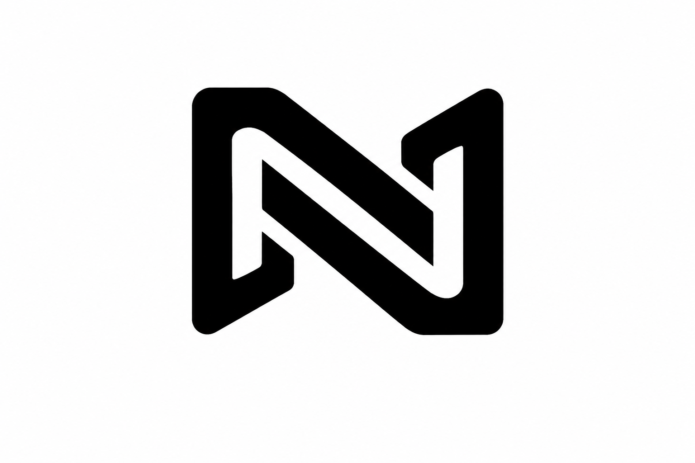
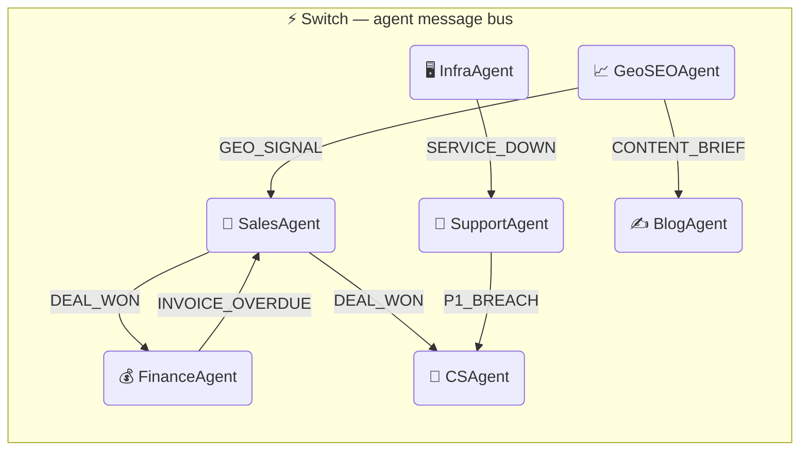

<div align="center">



# NEXUS

**AI agents that handle the cross-team coordination work your team shouldn't be doing manually.**

*Intelligence in Coordination.*

[](https://python.org)
[](https://github.com/sandbox-quantum/switch)
[](LICENSE)
[](https://switchagents.ai)
[](https://switchagents.ai)

[**Quick Start**](#quick-start) · [Setup Guide](docs/SETUP.md) · [Agent Reference](docs/AGENTS.md) · [Testing Guide](docs/TESTING_GUIDE.md)

</div>

---

> Most teams use AI as a chatbot. NEXUS makes AI a coordinated teammate network.  
> Remove Switch → agents cannot coordinate → all six chains break. The project stops working.

---

## Built for Track 01 — Best Business Workflow

NEXUS is a **practical, working workflow** where **people and AI agents get real business work done together** — inside the team chat they already use.

| Judging Criterion | How NEXUS Answers |
|---|---|
| **Switch (30%)** — Is Switch central? Would the project stop working without it? | Yes. Every cross-agent signal routes through Switch. Remove Switch and 6 automated chains break. No `list_agents()` → no dynamic fan-out. No `send_targeted_message()` → no targeted delivery. No `addressing_mode` → no access control. |
| **Technical execution (25%)** — Does it run? Can someone clone and reproduce it? | `make demo` boots Postgres, migrates, seeds, and launches all 7 agents in one command. GitHub Actions CI on every push. `LLM_MOCK_MODE=true` for zero-latency demos. All 6 signal chains covered by unit tests. |
| **Creativity and impact (25%)** — Fresh idea? Solves a problem a real team has? | Every B2B company has this problem. Deals die in silence. P0s reach customers before CS does. SEO data never reaches sales. NEXUS is the first product to solve cross-team coordination inside Slack — where teams already work. |
| **Presentation (20%)** — Do the README and demo video make Switch usage clear? | This README documents every Switch API call used. The demo video shows each chain firing live. |

**The workflow in one sentence:** A person triggers one action in Slack → Switch routes signals between AI agents across teams → the right people are notified, the right work gets done, with human approval at every critical gate.

**People + agents, working together — that is Track 01.**

---

## The Problem

Every B2B company runs on cross-team handoffs. Every single one of them is broken.

| Team | Current Reality | The Cost |
|------|----------------|----------|
| **Sales** | Spreadsheets, CRM nobody updates, follow-ups forgotten | Deals lost to silence |
| **Dev Support** | Bugs buried in DMs, no severity triage, no escalation path | P0s discovered by customers first |
| **SEO / Growth** | Siloed from sales, content decided by gut feel | Missed geo opportunities, irrelevant content |
| **Content** | No signal from market data, manual briefs, long publish cycles | Articles that don't rank |
| **DevOps** | Alerts in email, jobs fail silently, on-call finds out last | Downtime goes undetected |
| **Customer Success** | Renewals tracked in spreadsheets, churn caught too late | Revenue lost without warning |
| **Finance** | Invoice approvals over email, budget overruns noticed end of month | Cash flow surprises |

The problem is never a lack of information. The problem is that the right information never reaches the right person at the right time — because that requires someone to remember to send it.

**NEXUS removes the "someone remembers" dependency entirely.**

---

## What NEXUS Does

NEXUS puts one AI agent in every business Slack channel — Sales, Finance, CS, Support, Growth, Content, DevOps. Those agents handle commands from your team. And they coordinate with each other automatically over **Switch**, the open-source agent messaging protocol.

They don't wait to be asked. When a deal closes, the agents tell Finance and CS simultaneously. When a P0 drops, CS knows before the customer calls. When a keyword trends in India, a blog brief fires to Content and warm leads surface in Sales — in the same second.

```python
# Without Switch — hardcoded, blind, noisy
slack.chat_postMessage(channel=os.getenv("SLACK_CHANNEL_ID_CS"), text="DEAL_WON: Rahul")
# broadcasts to the whole channel · no presence check · breaks when anything moves

# With Switch — targeted, presence-aware, zero config
target = next(a for a in client.list_agents() if a["name"] == "cs-agent")
client.send_targeted_message(target["id"], "DEAL_WON: Rahul")
# direct delivery · silently skipped if offline · no hardcoded IDs
```

Each agent uses a **HybridClient** — Slack for user-facing output (Block Kit, slash commands, modals), Switch WebSocket for all agent-to-agent signals.

**Remove Switch → agents cannot communicate → all chains break.**

---

## Architecture

Each agent maintains a persistent WebSocket connection to Switch. When an event fires — a deal closes, a P0 drops, a service fails — the agent that knows about it calls `list_agents()` to find who is online, then fires a targeted signal directly to the right peer. No broadcast. No polling. No hardcoded IDs. No config changes when agents move.



---

## Switch — The Nervous System, Not the Glue

Switch is not an add-on. It is the reason this product exists. Without Switch, 7 isolated Slack bots sitting in 7 channels. With Switch, a coordinated operating layer where agents discover each other, communicate directly, and enforce access control at the protocol level.

**Every Switch API call used in NEXUS:**

| Switch API | Where It's Used | What It Enables |
|---|---|---|
| `list_agents()` | Every cross-agent signal | Dynamic discovery — agents find each other at runtime, no hardcoded IDs |
| `send_targeted_message()` | All 6 signal chains | Direct agent-to-agent delivery — not broadcast, not channel post |
| `addressing_mode: anyone` | SalesAgent, FinanceAgent, GeoSEOAgent, InfraAgent | Humans and agents can both send commands |
| `addressing_mode: owner_and_owner_agents` | CSAgent, SupportAgent, BlogAgent | Only agents can trigger at-risk alerts — protocol-level, not application-level |
| `read_context()` | SalesAgent follow-up drafts | LLM reads actual Switch room history — not a template, the real conversation |
| WebSocket persistent connection | All 7 agents | Agents stay connected — signals deliver in milliseconds, not minutes |
| `fan_out()` | DEAL_WON chain | One `list_agents()` call, parallel signals to Finance + CS — O(1) discovery |
| `record_heartbeat()` | All 7 schedulers | Live health tracking — `/nexus status` shows real-time presence |

**The proof:** Pull the Switch server plug during the demo. Within seconds, all 7 agents lose their heartbeat. The `/nexus status` command shows every dot turn red. No signals fire. No cross-agent chains complete. The product stops working — not degrades, stops.

---

## The Six Signal Chains

Six real business workflows. Six categories of coordination failure — eliminated permanently. Every single one routes through Switch.

> **For judges:** Each chain below is a workflow where a human takes one action in Slack, and Switch routes signals between AI agents so the right work gets done without further human coordination. This is Track 01 — Best Business Workflow — in its most literal form.

### 1 · Deal Won → Revenue Logged + Customer Onboarded

**What used to happen:** Rep closes a deal. Finance finds out next morning. CS finds out when the customer emails asking why nobody onboarded them.

**What happens now:**

```
SalesAgent  →  list_agents()  →  FinanceAgent + CSAgent both online
    ├── DEAL_WON → FinanceAgent   💰 Revenue logged in #nexus-finance
    └── DEAL_WON → CSAgent        🏆 Customer onboarded in #nexus-cs
```

```
In #nexus-finance:
💰 Revenue Logged
Vikram Nair  ·  Rs 8.0L  ·  Deal closed

In #nexus-cs:
🏆 New Customer Onboarded
Vikram Nair  ·  ARR Rs 8.0L  ·  Health tracking started
```

One `/won` command. Three channels updated. Zero human coordination. **Switch makes this possible:** SalesAgent calls `list_agents()` once to discover who is online, fires `send_targeted_message()` to both FinanceAgent and CSAgent in parallel. If one is offline, the other still fires. Without Switch, this requires two hardcoded API calls, two config entries, and breaks the moment either agent moves.

---

### 2 · P0 Bug Filed → CS Alerted Before the Customer Calls

**What used to happen:** Dev support files a P0 at 2am. CS finds out when an enterprise customer calls the account manager the next morning.

**What happens now:**

```
SupportAgent  →  LLM classifies severity: P0
    └── P1_BREACH → CSAgent        🚨 At-risk alert in #nexus-cs
```

CS knows about the outage before the customer does. Proactive outreach goes out. The customer feels taken care of instead of surprised. **Switch makes this possible:** CSAgent is configured with `addressing_mode='owner_and_owner_agents'` — users cannot spoof a P0 alert, only other agents can send it. This access control is enforced at the Switch protocol level, not in application code.

---

### 3 · Invoice Overdue → Sales Rep Flagged *(nightly, automated)*

**What used to happen:** Finance notices a 45-day unpaid invoice at the end of the month. Someone remembers to email the sales rep. The rep apologizes to the customer. Trust damage done.

**What happens now:**

```
FinanceAgent  →  APScheduler at 02:00  →  3 invoices overdue 30+ days
    └── INVOICE_OVERDUE → SalesAgent  ⚠️ Accounts flagged in #nexus-sales
```

```
In #nexus-sales (morning):
⚠️ Overdue Invoice — Account Flagged
Customer: Acme Corp  ·  Amount: Rs 45,000  ·  32 days overdue
Follow up with this account.   _Signal from FinanceAgent via Switch_
```

Reps wake up to flags. The agents coordinated overnight. Nobody scheduled it. Nobody remembered. It just happened. **Switch makes this possible:** APScheduler fires at 02:00, FinanceAgent queries overdue invoices, `send_targeted_message()` delivers a targeted signal to SalesAgent — not a broadcast to the channel, directly to the agent. Sales sees an actionable flag, not noise.

---

### 4 · Service Down → Bug Auto-Filed *(zero human intervention)*

**What used to happen:** Service fails. No PagerDuty rule configured. On-call engineer finds out when a customer tweets about it.

**What happens now:**

```
InfraAgent  →  checkout-api: 2× consecutive failure
    └── SERVICE_DOWN → SupportAgent   🐛 P0 bug auto-filed in #nexus-support
```

The bug filed itself. InfraAgent monitors every registered service on a 5-minute cycle. Two failures and the signal fires. No human involvement from failure to ticket. **Switch makes this possible:** InfraAgent calls `list_agents()`, finds SupportAgent online, fires `send_targeted_message()`. If SupportAgent is offline, the signal is dropped gracefully — no crash, no error, no noise in the channel.

---

### 5 · GEO Keyword Trends → Blog Draft Auto-Queued *(CONTENT_BRIEF)*

**What used to happen:** SEO analyst spots a trending keyword. Writes a Confluence doc. Mentions it in the weekly meeting. Blog post goes on the content backlog. It publishes three weeks later — if anyone remembered.

**What happens now:**

```
GeoSEOAgent  →  "best CRM for Indian startups" trending +280% in India
    └── CONTENT_BRIEF → BlogAgent   ✍️ 600-word draft queued in #nexus-content
```

```
In #nexus-content:
✍️ Blog Draft Ready
Title: "Best CRM for Indian Startups in 2026: A Practical Guide"
Meta: India-specific examples, FAQ schema, structured data included
[ ✅ Approve ]  [ 👁 Preview ]  [ ❌ Reject ]
```

One signal from Growth. BlogAgent generates the full post — title, meta description, H2 structure, India-specific examples. Human clicks Approve. Published. Card updates in place, buttons gone. The same post cannot be published twice. **Switch makes this possible:** `CONTENT_BRIEF` is delivered directly to BlogAgent via `send_targeted_message()` — BlogAgent's `addressing_mode` is `owner_and_owner_agents`, so only GeoSEOAgent can trigger it, not any user typing in Slack.

---

### 6 · GEO Signal → Warm Leads Surfaced in Sales *(simultaneously with Chain 5)*

**What used to happen:** SEO data never reached sales. The keyword that told you exactly who to call stayed in a Growth dashboard nobody checked.

**What happens now:**

```
GeoSEOAgent  →  same trigger as Chain 5, same instant
    └── GEO_SIGNAL → SalesAgent   📍 Pipeline leads surfaced in #nexus-sales
```

```
In #nexus-sales:
📍 Geo Signal: best CRM for Indian startups trending +280% in India
Keyword: best CRM for Indian startups   Volume: 14,000/mo

Active leads in pipeline:
• Vikram Nair (Prospect) — Mumbai — Rs 8.0L
• Priya Sharma (Qualified) — Bangalore — Rs 3.5L

[ ✍️ Draft Outreach for All ]
```

GeoSEOAgent fires `CONTENT_BRIEF` to BlogAgent and `GEO_SIGNAL` to SalesAgent in the same second. SalesAgent queries the pipeline for leads matching the geo, surfaces them with a one-click outreach button. Click "Draft Outreach for All" → LLM writes a personalized message for each lead, citing the trending keyword that makes them relevant right now.

**Three agents. One signal. Zero coordination overhead.** Growth identified the gap. Content drafted the fix. Sales has the outreach. Simultaneously. This loop is not possible to build without a shared coordination layer. That layer is Switch.

---

## The Escalation Engine

Missed commitments don't disappear. They compound. When a rep logs a commitment — a follow-up deadline, a proposal, a demo — the system tracks it. If it passes the due date without resolution:

```
Rep misses commitment
    └── Reminder → Rep (Day 1)
        └── Escalation → Team Lead (Day 2)
            └── Escalation → Sales Manager (Day 3)
                └── Escalation → VP Sales (Day 5)
                    └── Escalation → CEO (Day 7)
```

Humans are only pulled in when they need to be — at exactly the right seniority level for the size of the miss. The AI does 90% of the work. The escalation chain ensures the other 10% never gets dropped.

---

## Quick Start

**Prerequisites:** Python 3.11+ · PostgreSQL 16 · [Switch Console](https://github.com/sandbox-quantum/switch)

```bash
# 1. Clone
git clone https://github.com/deveshchandiramani2006/switch-hackathon
cd switch-hackathon

# 2. Install
pip install -r requirements.txt

# 3. Configure
cp .env.example .env
# → fill SLACK_BOT_TOKEN, SLACK_APP_TOKEN, SLACK_CHANNEL_ID_*

# 4. Start Switch server
cd /path/to/switch && just standalone-up
# → http://localhost:8000

# 5. Register all 7 agents (run once — auto-writes credentials to .env)
python3 register_agents.py

# 6. Create Switch rooms (run once — auto-writes room IDs to .env)
python3 setup_rooms.py

# 7. Set up the database
python3 database/migrate_fresh.py

# 8. Launch
python3 run_agents.py
```

Then type `/nexus status` in any Slack channel:

```
🟢 online   SalesAgent     nexus-sales
🟢 online   FinanceAgent   nexus-finance
🟢 online   CSAgent        nexus-cs
🟢 online   SupportAgent   nexus-support
🟢 online   GeoSEOAgent    nexus-growth
🟢 online   BlogAgent      nexus-content
🟢 online   InfraAgent     nexus-devops
```

> **No LLM API key?** Set `LLM_MOCK_MODE=true` in `.env`. All calls return realistic responses. All 6 signal chains still fire.

> **One-command demo:** `make demo` — Postgres up, migrate, seed, all 7 agents launched. Full system in one command.

---

## The 7 Agents

| Agent | Channel | Switch Room | What It Owns |
|---|---|---|---|
| **SalesAgent** | `#nexus-sales` | `nexus-sales` | Leads, pipeline, deal tracking, AI follow-ups, commitment tracking, escalation |
| **FinanceAgent** | `#nexus-finance` | `nexus-finance` | Invoices, approvals, expense claims, revenue logging, overdue detection |
| **CSAgent** | `#nexus-cs` | `nexus-cs` | Customer health scores, renewals, at-risk alerts, QBR generation |
| **SupportAgent** | `#nexus-support` | `nexus-support` | Bug triage, LLM severity classification (P0–P3), SLA tracking |
| **GeoSEOAgent** | `#nexus-growth` | `nexus-growth` | AI citability scoring, keyword tracking, full closed-loop GEO cycle |
| **BlogAgent** | `#nexus-content` | `nexus-content` | AI blog drafts, approval workflow, publishing, re-score trigger |
| **InfraAgent** | `#nexus-devops` | `nexus-devops` | Service monitoring, live HTTP pings, failure detection, auto P0 filing |

---

## Slash Commands

25 commands registered across 7 channels. `[M]` = modal · `[T]` = inline reply.

<details>
<summary><strong>Sales</strong> · <code>#nexus-sales</code></summary>

| Command | | Description |
|---|---|---|
| `/new-lead` | M | Log a lead — Name, Role, City, Industry, Deal Value |
| `/pipeline` | T | Active leads sorted by deal value |
| `/won Name` | T | Close deal → fires DEAL_WON to Finance + CS |
| `/lost Name` | T | Mark deal lost |
| `/follow-up Name` | T | LLM follow-up draft (pulls room history via `read_context`) |
| `/commitment` | M | Track a commitment — Lead, Text, Due Date |

</details>

<details>
<summary><strong>Finance</strong> · <code>#nexus-finance</code></summary>

| Command | | Description |
|---|---|---|
| `/invoice` | M | Create invoice — Vendor, Amount, Due Date, Category |
| `/approve ID` | T | Approve invoice |
| `/reject` | M | Reject invoice — ID + Reason |
| `/expense` | M | Expense claim — Submitter, Amount, Category, Date |

</details>

<details>
<summary><strong>Customer Success</strong> · <code>#nexus-cs</code></summary>

| Command | | Description |
|---|---|---|
| `/customer` | M | Add customer — Company, ARR, Renewal Date |
| `/health Name` | T | LLM health score + risk signals |
| `/expansion Name` | T | LLM upsell and cross-sell angles |
| `/qbr Name` | T | LLM-generated QBR agenda |
| `/nps` | M | Log NPS — Customer, Score, Note |

</details>

<details>
<summary><strong>Support</strong> · <code>#nexus-support</code></summary>

| Command | | Description |
|---|---|---|
| `/bug` | M | Log bug — Description + Severity (P0–P3) |
| `/bugs` | T | Open bugs with inline Resolve buttons |
| `/resolve #ID` | T | Close bug — card updates in place |

</details>

<details>
<summary><strong>Growth</strong> · <code>#nexus-growth</code></summary>

| Command | | Description |
|---|---|---|
| `/geo Keyword` | T | AI citability score + exact fixes |
| `/track` | M | Track a keyword for SEO monitoring |

</details>

<details>
<summary><strong>Content</strong> · <code>#nexus-content</code></summary>

| Command | | Description |
|---|---|---|
| `/draft` | M | AI blog draft — Topic + Target Geography |
| `/queue` | T | Drafts pending review with Approve / Reject buttons |

</details>

<details>
<summary><strong>DevOps</strong> · <code>#nexus-devops</code></summary>

| Command | | Description |
|---|---|---|
| `/service` | M | Register a service for monitoring — Name, URL |
| `/ping URL` | T | Live HTTP check — status code + latency |

</details>

---

## What Switch Enables

| Without Switch | With Switch |
|---|---|
| Hardcoded channel ID per agent pair | `list_agents()` — discover agents at runtime |
| Broadcast to channel, any reader picks it up | `send_targeted_message()` — direct P2P delivery |
| No way to know if the target is running | Signal silently dropped if target is offline |
| Config change needed to add or move an agent | Zero config — agents register themselves |
| HTTP polling or webhook | WebSocket with exponential-backoff reconnect |
| Anyone can send anything to any agent | `addressing_mode` enforced at the protocol level |

**Addressing modes** are set at startup and enforced by Switch — not application code:

| Agent | Mode | Why |
|---|---|---|
| SalesAgent | `anyone` | Reps trigger pipeline commands directly |
| FinanceAgent | `anyone` | Finance team approves invoices |
| CSAgent | `owner_and_owner_agents` | At-risk alerts must come from agents, not users |
| SupportAgent | `owner_and_owner_agents` | Auto-filed bugs must originate from InfraAgent |
| GeoSEOAgent | `anyone` | Growth team runs keyword scans on demand |
| BlogAgent | `owner_and_owner_agents` | CONTENT_BRIEF must come from GeoSEOAgent |
| InfraAgent | `anyone` | Ping commands and monitor alerts both need access |

---

## Where NEXUS Goes

NEXUS is not a seven-agent hackathon project. It is the foundation of a coordination platform that scales to every team, every workflow, every company size.

### The Next Agents

| Agent | Signal | What It Unlocks |
|---|---|---|
| **HR Agent** | `NEW_HIRE` → IT + Finance + CS simultaneously | Zero-touch provisioning — laptop ordered, payroll set up, onboarding started, all from one HR action |
| **Product Agent** | Support tickets → feature backlog | CS health scores → roadmap priority | The roadmap responds to what customers actually experience, not what PMs think they want |
| **Marketing Agent** | `MQL` → SalesAgent | Campaign spend → FinanceAgent | Marketing-to-sales handoff automated; budget burns tracked in real time |
| **Legal Agent** | Contract sent → FinanceAgent + SalesAgent | Deals don't stall waiting for someone to notice a contract came back |
| **RevOps Agent** | Cross-team revenue signals consolidated | Full-funnel visibility without a single spreadsheet |

### The Platform Vision

**Multi-tenant SaaS.** Each company gets fully isolated infrastructure — dedicated database, isolated LLM keys, independent escalation chains. One deployment. Zero cross-contamination.

**BYOLLM.** Bring your own model — OpenAI, Gemini, Ollama, any Anthropic model. Companies don't get locked into one provider. The LLM is a pluggable component, not an architectural dependency.

**Agent Memory.** Agents learn from every interaction. The sales agent that watched 200 deals close knows which signals predict a win. The CS agent that tracked 50 churn events knows the patterns before the customer says anything. The longer you use NEXUS, the smarter it gets.

**Proactive Intelligence.** Agents don't wait to be asked. When the GeoSEO agent detects that a competitor just started ranking for a keyword you've never targeted, it surfaces that unprompted. When the CS agent notices three enterprise customers reduced their usage in the same week, it flags the pattern before you even think to look.

**Three Deployment Models.**

```
┌─────────────────────┐  ┌──────────────────────┐  ┌────────────────────────┐
│   Hosted SaaS       │  │   Self-Hosted Docker  │  │   Management API       │
│                     │  │                       │  │                        │
│   Connect Slack.    │  │   Full control.       │  │   Build your own       │
│   Set escalation    │  │   Your infra.         │  │   agents on the        │
│   chains.           │  │   Your data.          │  │   NEXUS coordination   │
│   Start Monday.     │  │   Your LLM keys.      │  │   layer.               │
└─────────────────────┘  └──────────────────────┘  └────────────────────────┘
```

### The Compounding Advantage

The coordination value of NEXUS compounds with every agent added. Two agents: one chain. Seven agents: six chains. Fifteen agents: the chains multiply non-linearly because every new agent can receive signals from and send signals to every existing agent.

This is not a feature. It is a network effect inside a single company's operations.

> Waking up to work that got done without you. That's the moment that makes NEXUS irreplaceable.

---

## Stack

| Layer | Technology |
|---|---|
| Agent transport — UI | Slack Bolt + Socket Mode |
| Agent transport — signals | Switch WebSocket · `HybridClient` |
| Cross-agent signals | `send_targeted_message()` + `list_agents()` |
| LLM | Anthropic Claude Sonnet 4.6 / Ollama llama3.2 |
| Database | PostgreSQL 16 |
| Scheduler | APScheduler |
| UI components | Slack Block Kit · 11 modal forms |
| Testing | pytest · 5 unit tests · GitHub Actions CI |
| Containers | Docker Compose · per-agent Dockerfiles |

---

## License

MIT © 2026 — see [LICENSE](LICENSE)

---

<div align="center">

Built at the **Flip the Switch Hackathon** · Nov 4–7 2026 · Track 01: Best Business Workflow

**NEXUS is the coordination layer your company already needs — built inside the tool your team already uses.**

[Switch](https://github.com/sandbox-quantum/switch) · [Slack](https://slack.com) · [Anthropic](https://anthropic.com)

</div>
