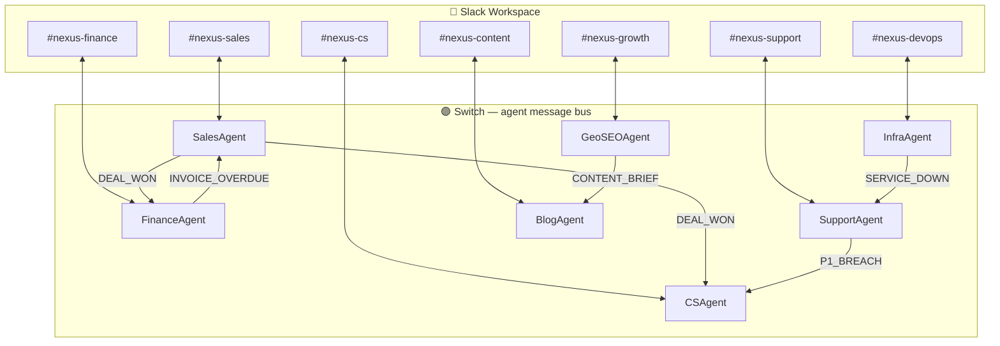

<div align="center">

# NEXUS

**7 AI agents. 5 autonomous signal chains. Zero human coordination.**

[](https://python.org)
[](https://github.com/sandbox-quantum/switch)
[](LICENSE)
[](https://switchagents.ai)

[**Quick Start**](#quick-start) · [Setup Guide](docs/SETUP.md) · [Agent Reference](docs/AGENTS.md) · [Testing Guide](docs/TESTING_GUIDE.md)

</div>

---

> Sales closes a deal. Finance logs the revenue. CS onboards the customer.  
> Nobody sent a message. The agents did it.

NEXUS puts one AI agent in every business Slack channel — Sales, Finance, CS, Support, Growth, Content, DevOps. They handle commands from your team and coordinate with each other automatically over **Switch**, the open-source agent messaging protocol.

---

## Table of Contents

- [How It Works](#how-it-works)
- [Architecture](#architecture)
- [Signal Chains](#signal-chains)
- [Quick Start](#quick-start)
- [The 7 Agents](#the-7-agents)
- [Slash Commands](#slash-commands)
- [What Switch Enables](#what-switch-enables)
- [Stack](#stack)
- [Project Structure](#project-structure)
- [Roadmap](#roadmap)
- [License](#license)

---

## How It Works

Each agent connects to Switch over a persistent WebSocket. When an event fires — a deal closes, a P0 bug drops, a service goes down — the agent that knows about it queries Switch for who is online, then sends a targeted signal directly to the right agent.

```python
# Without Switch — hardcoded, blind, noisy
slack.chat_postMessage(channel=os.getenv("SLACK_CHANNEL_ID_CS"), text="DEAL_WON: Rahul")
# broadcasts to the whole channel · no presence check · breaks when anything moves

# With Switch — targeted, presence-aware, zero config
target = next(a for a in client.list_agents() if a["name"] == "cs-agent")
client.send_targeted_message(target["id"], "DEAL_WON: Rahul")
# direct delivery · silently skipped if offline · no hardcoded IDs
```

Each agent uses a **HybridClient** — Slack for user-facing output (Block Kit, slash commands, modals), Switch WebSocket for all agent-to-agent signals.

**Remove Switch → agents cannot communicate → all 5 chains break.**

---

## Architecture



---

## Signal Chains

Five workflows that run with zero human coordination.

### 1 · Deal Won

Trigger: `/won Rahul Sharma` in `#nexus-sales`

```
SalesAgent  →  list_agents()  →  FinanceAgent + CSAgent both online
    ├── DEAL_WON → FinanceAgent   💰 Revenue logged in #nexus-finance
    └── DEAL_WON → CSAgent        🏆 Customer onboarded in #nexus-cs
```

One command. Three channels updated. Zero messages sent by humans.

---

### 2 · P0 Bug Breach

Trigger: `/bug` in `#nexus-support` with P0 severity

```
SupportAgent  →  LLM classifies severity: P0
    └── P1_BREACH → CSAgent        🚨 At-risk alert in #nexus-cs
```

CS knows about the outage before the customer calls.

---

### 3 · GEO Score Below Threshold

Trigger: `/geo best CRM for Indian startups` in `#nexus-growth`

```
GeoSEOAgent  →  LLM scores AI citability: 3 / 10  (below threshold)
    └── CONTENT_BRIEF → BlogAgent  ✍️ 600-word SEO draft queued in #nexus-content
```

Gap found in Growth. Draft queued in Content. No back-and-forth.

---

### 4 · Service Down

Trigger: InfraAgent background monitor (every 5 min) — 2 consecutive failures

```
InfraAgent  →  checkout-api: 2× failure
    └── SERVICE_DOWN → SupportAgent   🐛 P0 bug auto-filed in #nexus-support
```

The bug filed itself. No PagerDuty. No human paged.

---

### 5 · Invoice Overdue *(nightly scheduler)*

Trigger: APScheduler at 02:00 — invoices 30+ days unpaid

```
FinanceAgent  →  3 invoices overdue
    └── INVOICE_OVERDUE → SalesAgent  ⚠️ Accounts flagged in #nexus-sales
```

Reps wake up to flags. The agents coordinated overnight.

---

## Quick Start

**Prerequisites:** Python 3.11+ · PostgreSQL 16 · [Switch Console](https://github.com/sandbox-quantum/switch)

```bash
# 1. Clone
git clone https://github.com/your-org/nexus && cd nexus

# 2. Install
pip install -r requirements.txt

# 3. Configure
cp .env.example .env
# → fill SLACK_BOT_TOKEN, SLACK_APP_TOKEN, SLACK_CHANNEL_ID_*

# 4. Start Switch server
cd /path/to/switch && just standalone-up
# → http://localhost:8000

# 5. Register all 7 agents (run once — auto-writes credentials to .env)
python3 register_agents.py

# 6. Create Switch rooms (run once — auto-writes room IDs to .env)
python3 setup_rooms.py

# 7. Set up the database
python3 database/migrate_fresh.py

# 8. Launch
python3 run_agents.py
```

Then type `/nexus status` in any Slack channel:

```
🟢 online   SalesAgent     nexus-sales
🟢 online   FinanceAgent   nexus-finance
🟢 online   CSAgent        nexus-cs
🟢 online   SupportAgent   nexus-support
🟢 online   GeoSEOAgent    nexus-growth
🟢 online   BlogAgent      nexus-content
🟢 online   InfraAgent     nexus-devops
```

> **No LLM API key?** Set `LLM_MOCK_MODE=true` in `.env`. All calls return realistic responses. All 5 signal chains still fire.

---

## The 7 Agents

| Agent | Channel | Switch Room | Responsibilities |
|---|---|---|---|
| **SalesAgent** | `#nexus-sales` | `nexus-sales` | Leads, pipeline, deal tracking, AI follow-ups |
| **FinanceAgent** | `#nexus-finance` | `nexus-finance` | Invoices, approvals, expense claims, revenue |
| **CSAgent** | `#nexus-cs` | `nexus-cs` | Health scores, renewals, at-risk alerts |
| **SupportAgent** | `#nexus-support` | `nexus-support` | Bug triage, LLM severity (P0–P3) |
| **GeoSEOAgent** | `#nexus-growth` | `nexus-growth` | AI citability scoring, keyword tracking |
| **BlogAgent** | `#nexus-content` | `nexus-content` | AI blog drafts, approval workflow, publishing |
| **InfraAgent** | `#nexus-devops` | `nexus-devops` | Service monitoring, live HTTP pings, failure alerts |

---

## Slash Commands

25 commands registered across 7 channels. `[M]` = modal · `[T]` = inline reply.

<details>
<summary><strong>Sales</strong> · <code>#nexus-sales</code></summary>

| Command | | Description |
|---|---|---|
| `/new-lead` | M | Log a lead — Name, Role, City, Industry, Deal Value |
| `/pipeline` | T | Active leads sorted by deal value |
| `/won Name` | T | Close deal → fires DEAL_WON to Finance + CS |
| `/lost Name` | T | Mark deal lost |
| `/follow-up Name` | T | LLM follow-up draft (pulls room history via `read_context`) |
| `/commitment` | M | Track a commitment — Lead, Text, Due Date |

</details>

<details>
<summary><strong>Finance</strong> · <code>#nexus-finance</code></summary>

| Command | | Description |
|---|---|---|
| `/invoice` | M | Create invoice — Vendor, Amount, Due Date, Category |
| `/approve ID` | T | Approve invoice |
| `/reject` | M | Reject invoice — ID + Reason |
| `/expense` | M | Expense claim — Submitter, Amount, Category, Date |

</details>

<details>
<summary><strong>Customer Success</strong> · <code>#nexus-cs</code></summary>

| Command | | Description |
|---|---|---|
| `/customer` | M | Add customer — Company, ARR, Renewal Date |
| `/health Name` | T | LLM health score + risk signals |
| `/expansion Name` | T | LLM upsell and cross-sell angles |
| `/qbr Name` | T | LLM-generated QBR agenda |
| `/nps` | M | Log NPS — Customer, Score, Note |

</details>

<details>
<summary><strong>Support</strong> · <code>#nexus-support</code></summary>

| Command | | Description |
|---|---|---|
| `/bug` | M | Log bug — Description + Severity (P0–P3) |
| `/bugs` | T | Open bugs with inline Resolve buttons |
| `/resolve #ID` | T | Close bug — card updates in place |

</details>

<details>
<summary><strong>Growth</strong> · <code>#nexus-growth</code></summary>

| Command | | Description |
|---|---|---|
| `/geo Keyword` | T | AI citability score + exact fixes |
| `/track` | M | Track a keyword for SEO monitoring |

</details>

<details>
<summary><strong>Content</strong> · <code>#nexus-content</code></summary>

| Command | | Description |
|---|---|---|
| `/draft` | M | AI blog draft — Topic + Target Geography |
| `/queue` | T | Drafts pending review with Approve / Reject buttons |

</details>

<details>
<summary><strong>DevOps</strong> · <code>#nexus-devops</code></summary>

| Command | | Description |
|---|---|---|
| `/service` | M | Register a service for monitoring — Name, URL |
| `/ping URL` | T | Live HTTP check — status code + latency |

</details>

---

## What Switch Enables

| Without Switch | With Switch |
|---|---|
| Hardcoded channel ID per agent pair | `list_agents()` — discover agents at runtime |
| Broadcast to channel, any reader picks it up | `send_targeted_message()` — direct P2P delivery |
| No way to know if the target is running | Signal silently dropped if target is offline |
| Config change needed to add or move an agent | Zero config — agents register themselves |
| HTTP polling or webhook | WebSocket with exponential-backoff reconnect |
| Anyone can send anything to any agent | `addressing_mode` enforced at the protocol level |

**Addressing modes** are set at startup and enforced by Switch — not application code:

| Agent | Mode | Why |
|---|---|---|
| SalesAgent | `anyone` | Reps trigger pipeline commands directly |
| FinanceAgent | `anyone` | Finance team approves invoices |
| CSAgent | `owner_and_owner_agents` | At-risk alerts must come from agents, not users |
| SupportAgent | `owner_and_owner_agents` | Auto-filed bugs must originate from InfraAgent |
| GeoSEOAgent | `anyone` | Growth team runs keyword scans on demand |
| BlogAgent | `owner_and_owner_agents` | CONTENT_BRIEF must come from GeoSEOAgent |
| InfraAgent | `anyone` | Ping commands and monitor alerts both need access |

---

## Stack

| Layer | Technology |
|---|---|
| Agent transport — UI | Slack Bolt + Socket Mode |
| Agent transport — signals | Switch WebSocket · `HybridClient` |
| Cross-agent signals | `send_targeted_message()` + `list_agents()` |
| LLM | Anthropic Claude Sonnet 4.6 / Ollama llama3.2 |
| Database | PostgreSQL 16 |
| Scheduler | APScheduler |
| UI components | Slack Block Kit · 11 modal forms |
| Testing | pytest · 5 unit tests · GitHub Actions CI |
| Containers | Docker Compose · per-agent Dockerfiles |

---

## Project Structure

```
nexus/
├── agents/
│   ├── sales_agent/        # handlers.py · commands.py · Dockerfile
│   ├── finance_agent/
│   ├── cs_agent/
│   ├── support_agent/
│   ├── geo_seo_agent/
│   ├── blog_agent/
│   └── infra_agent/
│
├── app/Services/
│   ├── HybridClient.py     # dual-transport: Slack (UI) + Switch (signals)
│   ├── SwitchClient.py     # WebSocket · list_agents · send_targeted_message
│   ├── SlackClient.py      # Bolt · slash commands · Block Kit · modals
│   ├── LlmService.py       # Claude / Ollama router · LLM_MOCK_MODE
│   ├── ModalService.py     # 11 modal form definitions
│   └── BlockBuilder.py     # Block Kit helpers
│
├── tests/
│   └── Unit/
│       └── test_signal_chains.py   # 5 tests covering all signal chains
│
├── register_agents.py      # register all 7 agents with Switch (run once)
├── setup_rooms.py          # create Switch rooms, write IDs to .env (run once)
├── run_agents.py           # launch all 7 agents in one process
├── docker-compose.yml      # Postgres + all 7 agent containers
└── .github/workflows/ci.yml
```

---

## Roadmap

Three more signal chains planned:

| Chain | Signal | Route | Unlocks |
|---|---|---|---|
| Churn risk → outreach | `CHURN_RISK` | CSAgent → SalesAgent | Rep flagged before the renewal call |
| Publish → re-score | `POST_PUBLISHED` | BlogAgent → GeoSEOAgent | Closes the GEO feedback loop |
| Shared room context | `read_context()` | Sales + CS + Finance | LLM sees cross-team history |

---

## License

MIT © 2026 — see [LICENSE](LICENSE)

---

<div align="center">

Built at the **Flip the Switch Hackathon** · Nov 4–7 2026 · Track 01: Best Business Workflow

[Switch](https://github.com/sandbox-quantum/switch) · [Slack](https://slack.com) · [Anthropic](https://anthropic.com)

</div>
